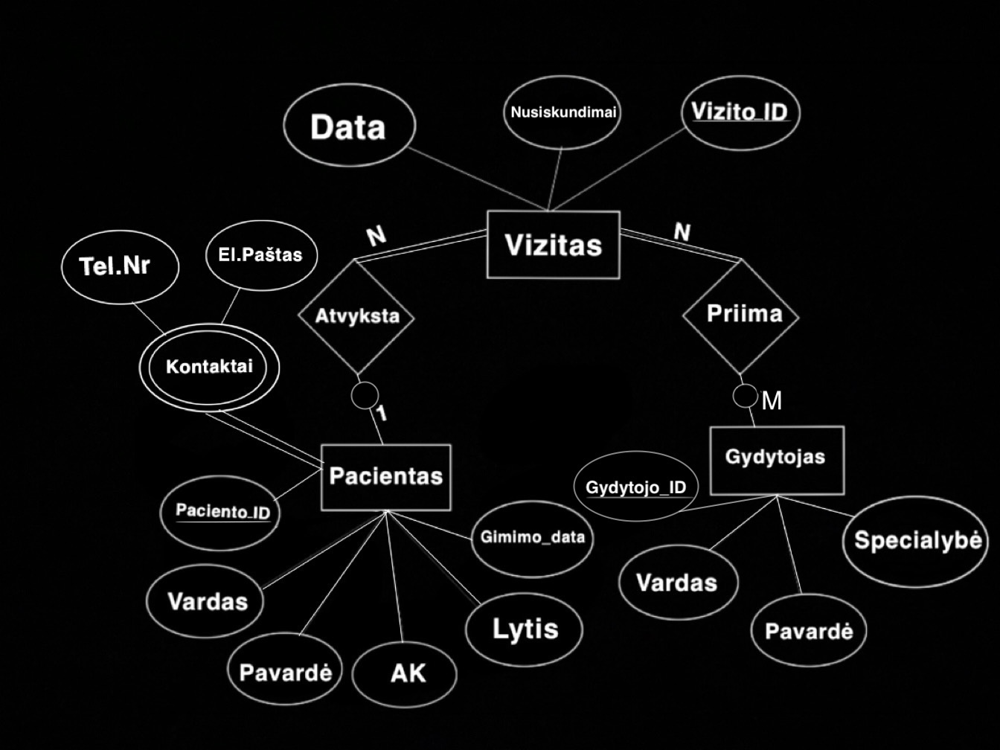

# Pacientų valdymo sistema – PostgreSQL

## Apie projektą

Šis projektas yra reliacinė duomenų bazė, skirta pacientų informacijai, jų kontaktiniams duomenims, medicininiams vizitams ir gydytojų informacijai saugoti bei valdyti.

Duomenų bazė sukurta naudojant **PostgreSQL**.

Projektą sudaro lentelių kūrimas, pirminiai ir išoriniai raktai, duomenų vientisumo apribojimai, indeksai, virtualios lentelės, pavyzdiniai duomenys ir analitinės SQL užklausos.

*Visi duomenys yra išgalvoti.

## Duomenų bazės struktūra



Duomenų bazę sudaro penkios pagrindinės lentelės:

| Lentelė | Paskirtis |
|---|---|
| `Pacientas` | Saugo pacientų asmeninę informaciją |
| `Kontaktai` | Saugo pacientų kontaktinius duomenis |
| `Vizitas` | Saugo informaciją apie pacientų vizitus |
| `Gydytojas` | Saugo gydytojų informaciją ir specialybes |
| `Priima` | Susieja vizitus su juos priimančiais gydytojais |

## Lentelių tarpusavio ryšiai

- Vienas pacientas gali turėti kelis vizitus.
- Vienas pacientas gali turėti kelis kontaktinius įrašus.
- Vieną vizitą gali aptarnauti keli gydytojai.
- Vienas gydytojas gali dalyvauti daugelyje vizitų.

Lentelė `Priima` realizuoja Many-to-Many ryšį tarp vizitų ir gydytojų.

## Pritaikytos SQL funkcijos ir principai

- Apribojimai: PRIMARY KEY, FOREIGN KEY, CHECK, NOT NULL, DEFAULT
- Automatiškai generuojami ID (GENERATED ALWAYS AS IDENTITY)
- ON DELETE CASCADE ir ON UPDATE RESTRICT ryšiuose
- Indeksai (UNIQUE pagal asmens kodą, paprastas pagal vardą)
- Virtualios lentelės (VIEW)
- OIN, LEFT JOIN, GROUP BY, HAVING, COUNT, DATE_TRUNC, AGE INSERT ir UPDATE


## Duomenų analizės pavyzdžiai

Projekte sukurtos SQL užklausos ([`sql/05_queries.sql`](sql/05_queries.sql)) atsako į šiuos klausimus:

1. Kiek vizitų turėjo kiekvienas pacientas?
2. Kurie gydytojai priėmė daugiausiai vizitų?
3. Kokios gydytojų specialybės yra dažniausiai pasitaikančios?
4. Kurie pacientai lankėsi daugiau nei vieną kartą?
5. Koks buvo paskutinis kiekvieno paciento vizitas?
6. Kaip galima surikiuoti gydytojus pagal vizitų skaičių?
7. Kurie gydytojai dar nėra priėmę pacientų?
8. Kaip pasiskirsto vizitų skaičius pagal mėnesius?
9. Kuriuos vizitus priėmė keli skirtingi gydytojai?

Pavyzdys – gydytojų rykiavimas pagal vizitų skaičių:

```sql
SELECT G.Gydytojo_ID, G.Vardas, G.Pavarde,
       COUNT(PR.Vizito_ID) AS Vizitu_sk,
       DENSE_RANK() OVER (ORDER BY COUNT(PR.Vizito_ID) DESC) AS Vieta
FROM Gydytojas G
LEFT JOIN Priima PR ON G.Gydytojo_ID = PR.Gydytojo_ID
GROUP BY G.Gydytojo_ID, G.Vardas, G.Pavarde
ORDER BY Vieta, G.Pavarde;
```

## Projekto struktūra

```
├── docs/
│   └── er_diagrama.jpg
└── sql/
    ├── 01_create_tables.sql   -- lentelės
    ├── 02_insert_data.sql     -- pavyzdiniai duomenys
    ├── 03_indexes.sql         -- indeksai
    ├── 04_views.sql           -- virtualios lentelės
    ├── 05_queries.sql         -- analitinės užklausos
    └── 06_updates.sql         -- duomenų atnaujinimas
```
